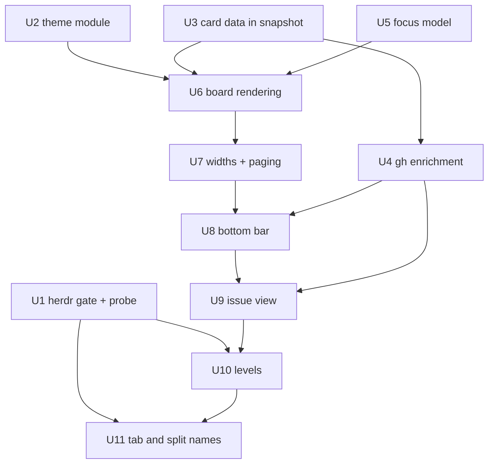
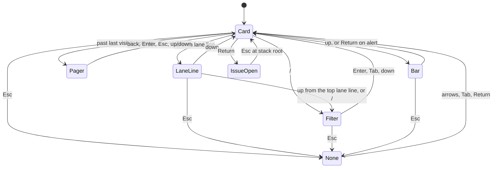
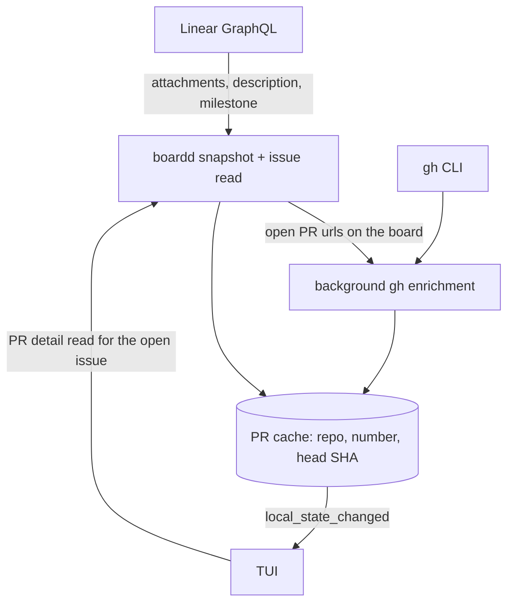

# Linear Board Redesign - Plan

## Goal Capsule

- **Objective:** A person working across herdr spaces can read the state of a Linear project at a glance and act on what agents need, in a board that looks like herdr, fits any pane width down to one 48-cell column, and shows each issue's pull requests, checks and attachments without leaving the terminal.
- **Means:** Port the agreed design from the tui-realm prototype into `board-tui`'s ratatui views and reducer (KTD1). Add the card and PR data the design needs to `board-core` and `board-daemon`, with Linear for issue data and `gh` for git data (KTD7, KTD8).
- **Authority:** `docs/board-design.md`, `docs/responsive-board.md` and `docs/issue-detail-inventory.md` own the design. This plan's requirements cite them. Where this plan and those docs disagree, the docs win on look and behaviour, and the KTDs win on mechanism. The prototype at `~/projects/tuirealm-toy` (commit 1c1b43d) is a visual reference, not a spec.
- **Stop conditions:**
  - U1's live probe shows that herdr 0.9.3 changes a wire shape the board uses. Stop before widening the gate and report the diff. The decision to widen stands; adapting to the changed shape becomes its own unit before the gate opens.
  - U1 shows that `pane.layout` or the focus events cannot tell a full pane from a split. Stop U10 and report; units U2–U9 continue.
  - A unit would need to change the classic (non-Linear) board's rendering or its snapshots. Stop and report.
- **Execution profile:** Rust workspace, sandbox-first (`AGENTS.md`). All gates and e2e run through `./scripts/sandbox.sh`. Test-first for behaviour.
- **Ship:** each unit lands as a PR into `feature/board-design`, which merges to `main` as one PR at the end (the fork has no `dev` branch).

---

## Product Contract

### Summary

Replace the Linear board's look, keys and issue page with the agreed redesign. The work covers:
- the herdr theme and a borderless powerline board with aligned, foldable swimlanes and fixed-height cards
- a context-aware bottom bar, fluid widths with paging and 2-up cards
- an issue view that opens as a modal, expands or pins beside the board, with PR and attachment cards
- automatic space / tab / split levels from the board's place in herdr
- generated names for every tab and split in the board's space

### Problem Frame

Shawn switches between herdr spaces all day and loses track of where work stands. The Linear board (PRs #4, #6, #7) shows the data, but it looks unlike herdr. It wastes width on borders and fixed 36-cell columns. It hides its keys, and it shows nothing about an issue's pull requests or CI. Lanes do not line up across columns, so scanning a lane means reading every column. The redesign was iterated in a prototype over two sessions until it read well at a glance. This plan moves it into the real board.

### Requirements

**Theme**
- R1. The board renders with herdr's active theme. Colours come from herdr's palette tokens for the theme named in herdr's config, with `[theme.custom]` overrides applied (`docs/board-design.md` §1).
- R2. Surfaces are one tone above what they sit on, and unfocused columns use the muted tones (`docs/board-design.md` §1, §3).

**Board**
- R3. Columns have no borders; column titles form one powerline bar with herdr's active and inactive tab styles. Linear view tabs form a second powerline row above it (`docs/board-design.md` §2, §3b).
- R4. Swimlanes are one line per lane across all columns, align across columns, and fold and unfold from their line (`docs/board-design.md` §2).
- R5. Cards have a fixed height. Selecting one changes only its surface, title colour and inner rules (`docs/board-design.md` §3).
- R6. The board scrolls vertically as one unit and keeps the selected item fully visible.

**Focus and keys**
- R7. Keys follow `docs/board-design.md` §4, including nothing-selected, the filter revealed by ↑ from the top, Esc deselect, ctrl+q quit and an inert `q`.
- R8. `a` / `x` still answer a `◇` suggestion on a selected card, and `n` / `N` still walk marked cards.

**Bottom bar**
- R9. The bottom bar shows global controls, a tip for the current selection, and board-wide alerts, and stacks into three centred rows when narrow (`docs/board-design.md` §5).
- R10. Show-requests appear as bar alerts. `a` / `x` on a selected request alert accept or dismiss it (`docs/board-design.md` §3b).

**Responsive**
- R11. Column count, card width, 2-up and paging follow `docs/responsive-board.md` Width. Resizing re-fits immediately.
- R12. Paging buttons work as an overlay that never moves the selected issue (`docs/responsive-board.md` Width, Hidden columns).

**Issue view**
- R13. Return opens the issue as a modal in wide views, or full-board in narrow ones; `e` expands; `o` pins it into a column slot (`docs/responsive-board.md` Opening an issue).
- R14. Everything behind a modal is muted; the bottom bar is not.
- R15. The issue view has a full-width header and bottom bar, a padded body, and a two-column layout with a full-height sidebar when wide (`docs/board-design.md` §6).
- R16. The issue view shows attachments and pull requests as cards, with each PR's checks, merge blocker, diff, reviews and preview (`docs/board-design.md` §6, §7).

**Data**
- R17. Cards show a description excerpt, milestone, newest agent note, and the PR row (number, preview, diff, CI) when the issue has a PR.
- R18. When `gh` is missing or fails, the board still shows Linear's PR data and says why the rest is missing.

**Levels**
- R19. The board shows the space board when it fills its tab, and the active split's issue when it is one split among several (`docs/responsive-board.md` Level).
- R20. `board tui --session` keeps working.

**Naming**
- R21. Every tab and split in the board's space always has a name, derived from its scope: an issue-bound tab is `WEB-101 · <title>`, an issue-bound split is `WEB-101 · <agent>`, and anything else is `<repo or folder> · <agent>` (or the folder alone with no agent). Names set by hand are never overwritten; the board replaces only names it generated, or blank ones.

### Key Decisions

- **Herdr gate widened to 0.9.0–0.9.3.** Shawn runs 0.9.3 and the levels need herdr calls through the gated connect (session-settled: user-directed — chosen over keeping 0.9.0 only: the board could not talk to the herdr Shawn runs). Governs R19.
- **Existing pieces placed per `docs/board-design.md` §3b.** View tabs become a powerline row, show-requests become bar alerts, the spaces strip stays on the not-bound screen, and the newest note replaces the last description line (session-settled: user-directed — chosen over dropping them or designing them first). Governs R3, R10, R17.
- **New keys win.** `?` opens the bar and the help sheet becomes a bar item; `o` means Overlay; `q` is inert; Esc deselects (session-settled: user-directed — chosen over keeping today's bindings). Governs R7, R13.
- **No always-on detail column.** Issues open as a modal, expanded, or pinned in a column slot (session-settled: user-directed — chosen over a permanent right-hand panel). Governs R13.
- **Cards keep CI and diff.** The design shows them on cards and as alerts, so `gh` data covers on-board PRs, not just the open issue (session-settled: user-directed — the card design with the PR row was iterated and accepted). Governs R17, R9.
- **Tabs and splits get generated names.** Every tab and split in the board's space gets a name derived from its scope, and hand-set names win (session-settled: user-directed — chosen over naming only board-launched panes). Governs R21.

### Scope Boundaries

- The classic (non-Linear) board keeps its look; its snapshots stay byte-identical.
- No Linear writes (status, assignee, comments).
- Mouse: sideways scroll and Shift+wheel page the board; clicks keep today's targets (card, column title). Clickable bar items, buttons and lane lines are not added.

#### Deferred to Follow-Up Work

- The list view below one column width (48 cells). It was never prototyped. Below 48 cells the board shows one column.
- herdr `auto_switch` light/dark theme switching. The board uses `[theme] name` only.
- A no-Nerd-Font fallback for icons.
- Capturing the herdr layout/focus findings and gh pitfalls as `docs/solutions/` entries after landing.
- PRs that are not attached to the issue in Linear. The board finds PRs only through Linear attachments (KTD7); a PR without one does not appear.

### Sources

- Design docs: `docs/board-design.md`, `docs/responsive-board.md`, `docs/issue-detail-inventory.md`.
- Prototype: `~/projects/tuirealm-toy` @ 1c1b43d (`src/main.rs`, `src/issue_view.rs`).
- Learnings: `docs/solutions/integration-issues/serde-default-rejects-explicit-null.md`, `docs/solutions/integration-issues/a-pinned-version-check-has-a-twin.md`; prior plans `docs/plans/2026-09-16-0929-feat-linear-mode-pickers-and-layout-plan.md`, `docs/plans/2026-09-30-2029-feat-linear-tui-design-plan.md`.

---

## Planning Contract

### Key Technical Decisions

- KTD1. **Port the design into the existing ratatui views and reducer, not tui-realm.** The board keeps one pure reducer, its effect gate and snapshot tests (session-settled: user-approved — chosen over adopting tui-realm: the prototype showed the usability came from design choices, not the framework).
- KTD2. **One focus model for the board.** A `Focus` value replaces the three never-empty indices (`sel_tab`, `sel_group`, `sel_card` in `app/linear.rs`): `Card`, `LaneLine`, `Filter`, `Pager(side)`, `Bar(item)`, `Pinned` (the pinned issue panel, KTD12) and `None` (remembering the last column). A vanished pin returns `Pinned` focus to the last card. Issue state is separate: an open slot with an intent (`Window` or `Expanded`) plus an optional pinned slot. Every variant has a refind rule after a snapshot arrives:
  - A card that moved to a hidden page pages the board to it.
  - A card in a folded or filtered-out lane selects that lane's line, or the next one.
  - A vanished lane moves to the next lane line.
  - A vanished pager button falls back to the edge column.
  - A vanished bar item clamps the index and refuses `a` / `x` with a toast.
- KTD3. **Lanes are a tab-level list.** The board builds one ordered lane list per tab, the union of `group.lanes` keys across columns. Each band's height is the busiest column's rows, so the lane lines are drawn once across the board. Fold state is kept per tab, keyed by lane key. It survives refreshes, and a lane that disappears drops its fold.
- KTD4. **One board-wide vertical offset.** It follows the selected item with the smallest scroll that keeps it fully visible. A lane band taller than the viewport scrolls within the band. This replaces per-column windowing (`visible_items` in `view/linear.rs`).
- KTD5. **A theme module owns every colour.** `board-tui` gets a `theme` module: herdr's built-in palettes keyed by theme name, transcribed from herdr v0.9.3 `src/app/state.rs`, plus `[theme.custom]` overrides. It derives the non-token tones from the palette and pins them for gruvbox: app background `#1e1e1e`, muted card `#262626`, muted text `overlay0`, muted detail one step dimmer. The herdr config is read once at start by extending the existing reader in `herdr_keys.rs`. An unknown theme name falls back to gruvbox. Views take styles from the theme, never named colours.
- KTD6. **The modal fades what is behind it with a buffer pass.** After the board is drawn, every cell in the body area outside the modal is blended about 60% toward the app background, then the modal draws on top. The bottom bar is outside the pass.
- KTD7. **Linear attachments say which PRs belong to an issue.** The issue read adds `attachments` to its detail fields. The snapshot read adds the newest GitHub PR attachment per issue for the card row, plus `description` and the milestone that is already fetched. Every new wire field is `Option` or defaults empty and accepts a present `null` (`docs/solutions/integration-issues/serde-default-rejects-explicit-null.md`).
- KTD8. **`gh` runs in the daemon, cached, never in the TUI.** A `GhClient` takes its pipe draining and deadline from the child-process code in `board-daemon/src/session.rs`: binary from `GH_BIN` (default `gh`), drained pipes, deadline, output cap, and no logging of argv or env. The environment allowlist is new code, since that herdr child inherits the full environment: `env_clear`, then `HOME`, `PATH`, `GH_TOKEN`, `GITHUB_TOKEN`, `GH_HOST`, `GH_CONFIG_DIR`, `XDG_CONFIG_HOME` and `DBUS_SESSION_BUS_ADDRESS` (Linux keyring auth needs the last one). Each PR takes up to three calls: `gh pr view <n> -R <owner>/<repo> --json …` (state, mergeability, diff, reviews, head), `gh pr checks <n> -R <owner>/<repo> --required --json name,state,bucket` (which required check blocks), and `gh api repos/<owner>/<repo>/deployments?ref=<branch>` then its statuses (preview URL). Results are cached by (repo, number) with the head SHA recorded. A background pass enriches the open PRs of on-board issues when a snapshot changes. While at least one board is subscribed, it also re-runs every 2 minutes for PRs whose checks are still pending or whose entry is older than 10 minutes. It is capped in concurrency, debounced, and emits `local_state_changed` when it finishes. The snapshot read merges each card's cached summary (CI state, diff, preview, blocker) into the card's PR field, so cards and bar alerts need no extra read. The TUI reads full PR detail for an open issue through a new method. "gh unavailable" gets its own protocol code, and the board degrades to Linear's PR data (session-settled: user-approved — chosen over the TUI calling gh: one cache shared by every open board and by agents).
- KTD9. **New daemon methods are optional to the TUI.** `MethodNotFound` on a PR or pane-context read means "older daemon": the board shows Linear-only PR data and the space level, never the stale-daemon screen.
- KTD10. **Levels come from the daemon, not from herdr in the TUI.** `board-tui` stays free of `board-herdr` (`AGENTS.md` crate ownership). A daemon method returns the caller pane's tab layout and the issue bound to a given pane, resolved from pane → cwd → binding with the tab's binding as fallback. A new boardd event forwards `pane_focused` and `layout_updated` for the caller's tab. The TUI remembers the last focused pane that is not itself. A level change never interrupts an open modal, filter or bar; it applies on the next return to the board. A board opened as a herdr overlay (as `scripts/open-board.sh` does) has no tile of its own and always shows the space board; U1 records how the daemon tells an overlay from a tile. The pane → issue lookup reuses the `linear.session.get` resolution rather than a second copy.
- KTD11. **Split level is read-only.** It shows the issue view in narrow mode without buttons and allows no mark clears, binds or show answers, matching today's session pane contract (`app/session.rs`). `board tui --session` becomes an alias that starts at the split level for the pane named in `BOARD_SESSION_*`. At the split level, linked-issue navigation and scrolling work; Esc at the stack root switches to the space board until the next focus change re-resolves the level.
- KTD12. **Issue open mode follows width at draw time.** The person's intent (`Window` or `Expanded`) is stored; below 136 cells the view renders narrow regardless and restores the intent when width returns. A pin is kept while the board has at least two columns' room. Below that, the panel hides and the bar tip says the issue is still pinned. `e` and `o` act only where their buttons are drawn; in the narrow view they do nothing and the tip says why. `o` in a modal while another issue is pinned replaces the pin. `p` moves focus into the pinned panel (↑↓/jk and PgUp/PgDn scroll it; Return follows links and pane rows; Esc or `p` returns focus to the board). The modal fills the body area less one row above and below, so it never covers the header or the bar.
- KTD13. **Esc on the issue view steps back through linked issues, then closes.** Backspace and ← do the same. This keeps today's back-stack behaviour (`leave_issue_page`).
- KTD14. **Widths are display cells.** All fitting uses `unicode-width`. Nerd Font and powerline glyphs are treated as one cell, the same way the snapshot backend measures them.
- KTD15. **Outside text is checked before use.** Linear attachment URLs are written by anyone in the Linear workspace. The daemon parses each PR URL into host, owner, repo and number. It accepts only `github.com` or the configured `GH_HOST`, owner and repo matching `^[A-Za-z0-9_.-]+$` (and not `.` or `..`), and a numeric number. It builds `gh` argv only from those parts and never passes the raw URL. Linear and GitHub text (descriptions, notes, attachment fields, check names, links) must not reach the terminal as control sequences. A render test with ESC and OSC payloads proves it, and a sanitizer at the view boundary is added if ratatui does not already drop them.
- KTD16. **The daemon owns tab and split names, and remembers the names it wrote.** herdr does not record who set a label. The daemon stores each label it writes, keyed by (session socket, tab or pane id). It renames a tab or pane only when the current label is blank (pane label `null` or empty; tab label empty or herdr's default, which U1 records) or still equals the stored label. Any other label is hand-set and never touched. Names are derived from the scope: the bound issue's key and title for a tab, the issue key and agent for a split, else the repo or folder name and agent. Labels are capped at 40 display cells. The daemon re-derives them on binding changes and on herdr `tab.created`, `pane.created` and agent-status events. It uses `tab.rename` and `pane.rename` through the gated connect (`herdr_conn.rs`), only for tabs in the board's own space.

### High-Level Technical Design

Unit dependencies and parallel waves:

Board focus states (KTD2). Issue states sit on top of these: a modal or expanded view takes the keys; a pinned panel leaves them with the board.

PR data flow (KTD7, KTD8):

### Sequencing and Parallelism

| Wave | Units | Why they can run together |
|---|---|---|
| 1 | U1, U2, U3, U5 | Separate areas: the `board-herdr` gate, a new theme module, daemon + protocol fields, and the reducer. No shared files except `CHANGELOG.md`, where each adds its own line |
| 2 | U4, U6 | U4 is daemon-only and U6 is TUI views; they touch no common file |
| 3 | U7 → U8 → U12 → U9 | Sequential: all three edit `view/linear.rs` and `app/linear.rs`, so parallel branches would conflict on every merge |
| 4 | U10 | Needs U1's probe findings and U9's narrow issue view |
| 5 | U11 | Edits `watchers/herdr.rs` after U10 and uses U1's recorded default tab label |

Each wave-1 and wave-2 unit runs in its own worktree. `CHANGELOG.md` and `docs/tui-interactions.md` are shared append-only files: merge each unit after rebasing onto the integration branch, and check both sides of the union (a clean auto-merge on a shared file is the risky case).

### Assumptions

- Every herdr user runs a Nerd Font terminal (the design's icons need one).
- `gh` uses the auth of the environment the daemon was started from; the daemon forwards only the KTD8 allowlist.

### Implementation Constraints

- Snapshot tests: each unit lists the Linear snapshots it re-records, deletes renamed `.snap` files by name, and leaves `crates/board-tui/tests/snapshots/` (classic board) byte-identical. Colour is asserted with `fg_at` / `bg_at` style checks, since `.snap` files hold text only.
- Every new key updates `HELP_KEYS`, `tests/interaction_contract.rs` and `tests/help.rs` together. Every new `Effect` is classified in `driver/linear.rs` allow/deny lists.
- Each unit updates its docs (`docs/tui-interactions.md`, `docs/protocol.md`, `docs/herdr.md`) and one `CHANGELOG.md` Unreleased entry. `test_docs.py` accepts only `nelsonPires5/herdr-board/pull/N` links, so entries use the `#0` placeholder until the upstream PR exists.
- The two earlier assumptions this design supersedes, the 72-cell stacking threshold and the 5-row card (`docs/plans/2026-09-16-0929-feat-linear-mode-pickers-and-layout-plan.md`), must be named as superseded where the code changes them.

---

## Implementation Units

### U1. Herdr gate 0.9.0–0.9.3 and live probe

**Goal:** The board connects to herdr 0.9.0 through 0.9.3, and `docs/herdr.md` records the layout and focus facts U10 depends on.

**Requirements:** R19 (via the Key Decision on the herdr gate).

**Dependencies:** none.

**Files:**
- `crates/board-herdr/src/lib.rs`, `crates/board-herdr/src/client.rs` (version check)
- `e2e/lib.sh` (its own version check)
- `docker/Dockerfile`, `scripts/sandbox.sh` (a `HERDR_VERSION` build arg with a SHA-256 per version and architecture; default stays 0.9.0)
- `scripts/tests/test_docs.py`, `AGENTS.md`, `docs/README.md`, `docs/herdr.md`, `.github/workflows/ci.yml`, `CHANGELOG.md`
- tests: `crates/board-herdr/src/client.rs` unit tests

**Approach:**
1. Make the sandbox image buildable at 0.9.3 (the image pins 0.9.0 by SHA). In a 0.9.3 sandbox, run `herdr api schema --json` and diff it against `docs/herdr-0.9.0-schema.json`. Stop (Goal Capsule) on any change to a shape the board uses.
2. Widen the accepted range to 0.9.0–0.9.3 in every place that checks it. Grep the constant and the literal (`a-pinned-version-check-has-a-twin.md`).
3. Probe, against an ephemeral `hb-e2e-*` session:
   - whether an overlay pane appears in `pane.layout`
   - the payloads of `pane_focused` and `layout_updated`
   - whether a pane's cwd is readable
   - how layout rects compare with a pane's terminal size
   - herdr's default label for a new tab, and whether `tab.renamed` and `pane.updated` fire on a rename (U11)
   Record the results in `docs/herdr.md`.

**Execution note:** the probe is a spike; its findings can trigger the U10 stop condition.

**Test scenarios:**
- Versions `0.9.0`, `0.9.0-preview.1`, `0.9.2` and `0.9.3` are accepted.
- `0.8.9`, `0.9.4` and `1.0.0` are refused with the existing version error.
- `test_docs.py` passes with the new range and the matching docs text.

**Verification:** sandbox gates and the e2e suite pass on 0.9.0 in CI and in a 0.9.3 sandbox image; the board's daemon reports herdr present on a 0.9.3 host.

### U2. Theme module

**Goal:** Every Linear-mode colour comes from herdr's theme.

**Requirements:** R1, R2.

**Dependencies:** none.

**Files:**
- create `crates/board-tui/src/theme.rs`
- modify `crates/board-tui/src/herdr_keys.rs` (read `[theme]` in the same config read)
- modify `crates/board-tui/src/driver/mod.rs` (`LinearStart` carries the theme), `crates/board-cli/src/main.rs`
- modify `crates/board-tui/tests/linear/fixtures/herdr-config.toml`
- tests: `crates/board-tui/tests/theme.rs`

**Approach:**
- Embed herdr's built-in palettes keyed by theme name (KTD5) and apply `[theme.custom]`.
- Expose role-named styles (card, card-active, card-muted, title-active, title-inactive, rule, lane, mark per kind, and so on) so views never name a colour.
- The session path receives the theme too.

**Patterns to follow:** `herdr_keys.rs` (path resolution, 64 KiB cap, silent fallback).

**Test scenarios:**
- `name = "gruvbox"` yields `panel_bg #282828`, `accent #d79921` and app background `#1e1e1e`.
- `[theme.custom] accent = "#ff0000"` overrides only the accent.
- An unknown theme name falls back to gruvbox.
- A missing, oversized or malformed config falls back to gruvbox without an error.
- A theme with a light `panel_bg` still derives muted tones that differ from the card surface.

**Verification:** theme tests pass, and every role U6 draws with exists in the theme.

### U3. Card data in the snapshot

**Goal:** Each snapshot issue carries what the 13-row card shows.

**Requirements:** R17.

**Dependencies:** none.

**Files:**
- `crates/board-daemon/src/linear/queries.rs` (`ISSUE_FIELDS`, `ISSUE_DETAIL_FIELDS`)
- `crates/board-daemon/src/ops/linear/native.rs` (`linear_issue`, `issue_detail`)
- `crates/board-core/src/protocol.rs` (`LinearIssue`, `LinearIssueDetail`)
- `e2e/fake-linear.py`, `docs/protocol.md`, `CHANGELOG.md`
- tests: `crates/board-daemon/src/ops/linear/native.rs` tests, `crates/board-core/tests/protocol.rs`

**Approach (KTD7):**
- The snapshot adds `description` (trimmed to an excerpt), the mapped milestone, and the newest GitHub PR attachment (repo, number, url, status, draft).
- The issue read adds all attachments (`sourceType`, title, subtitle, url, metadata) with a `truncated` entry.

**Test scenarios:**
- An issue with a description, a milestone and one GitHub PR attachment maps all three.
- An attachment whose `subtitle`, `metadata` or `sourceType` is `null` maps without failing the list.
- An issue with `githubCommit`, `slack` and an upload attachment keeps all three in the detail and none in the card PR field.
- More than 50 attachments marks `attachments` truncated.
- The e2e fake serves attachments, and scenario 42 still makes one GraphQL call per issue read.

**Verification:** daemon and protocol tests pass; `board linear issue` prints attachments.

### U4. gh enrichment in the daemon

**Goal:** The daemon knows each on-board PR's state, checks, merge blocker, diff, reviews and preview URL.

**Requirements:** R16, R17, R18.

**Dependencies:** U3.

**Files:**
- create `crates/board-daemon/src/gh.rs` (client + cache)
- modify `crates/board-daemon/src/ops/mod.rs` (new PR read method), `crates/board-daemon/src/ops/linear/native.rs` (enrichment pass after snapshot change), `crates/board-daemon/src/settings.rs` (`GH_BIN`, env allowlist)
- modify `crates/board-core/src/protocol.rs` (PR detail types, gh-unavailable code), `crates/board-core/src/client/traits.rs`, `crates/board-core/src/client/fake.rs`
- `docs/protocol.md`, `CHANGELOG.md`
- tests: `crates/board-daemon/tests/gh.rs`

**Approach (KTD8, KTD15):**
- Validate every PR URL into (host, owner, repo, number) before any `gh` call.
- Deduplicate `statusCheckRollup` to the latest result per check name.
- Report the blocker as the required check (from `gh pr checks --required`) or review that keeps `mergeStateStatus` blocked.
- Take the preview from the newest deployment status's `environment_url`.
- Merge each cached summary into the snapshot's card PR field.
- Cap the enrichment pass's concurrency; refresh only on the KTD8 triggers.

**Patterns to follow:** `board-daemon/src/session.rs` (child process), `board-core/src/opencode_catalog.rs` (output cap), `linear/cache.rs` and `native.rs` `schedule_refetch` (cache, debounce, event).

**Test scenarios:**
- A captured `gh pr view` JSON for an open PR maps to: 11 passed, 1 pending and 11 skipped, with blocker "E2E Verification Required (required) is pending".
- Two runs of the same check name count once.
- A `reviewDecision: null` and `mergedAt: null` payload maps without failing.
- `gh` missing returns the gh-unavailable code, and the board read still succeeds.
- `gh` exiting non-zero for one PR records that PR's error and leaves the others intact.
- A child exceeding the deadline is killed and reported as timed out.
- A snapshot change triggers one enrichment pass. A second change within the debounce window does not start a second pass.
- The child environment holds only the KTD8 allowlist, even when the daemon's own environment has other variables.
- A URL whose host is not `github.com` or `GH_HOST`, whose owner or repo starts with `-` or is `..`, or whose number is not numeric is refused, and no `gh` child starts.
- With a board subscribed, a PR with pending checks is re-fetched after 2 minutes; with no board subscribed, nothing is re-fetched.
- A snapshot read after enrichment carries each card's CI state, diff and preview.

**Verification:** tests pass with a fake `GH_BIN` script; no test invokes the real `gh`.

### U5. Focus model and keys

**Goal:** The board's selection follows KTD2 and the key table in `docs/board-design.md` §4.

**Requirements:** R7, R8, R4 (folding), R10 (`a` / `x` routing).

**Dependencies:** none.

**Files:**
- `crates/board-tui/src/app/linear.rs` (`LinearState`, `linear_key`, `board_key`)
- `crates/board-tui/src/app/linear_cursor.rs` (tab lane list, fold state, refind)
- `crates/board-tui/src/app/mod.rs` (ctrl+q above the chord guard)
- `crates/board-tui/src/view/mod.rs` (`HELP_KEYS`)
- `docs/tui-interactions.md`, `CHANGELOG.md`
- tests: `crates/board-tui/tests/linear/focus.rs` (new), `tests/interaction_contract.rs`, `tests/help.rs`

**Approach:**
1. Introduce `Focus` and the tab lane list (KTD3).
2. Route keys per state: the filter reuses the picker's filter-text model; ↑ from the top item reveals it.
3. Handle ctrl+q before the chord guard in both `linear_key` and `app/mod.rs`.
4. `a` / `x` act on a selected `◇` card first and otherwise do nothing on the board (show-requests move to the bar in U8).
5. On a lane line, ←→ and Tab change the focused column and keep the lane line selected. An empty focused column, or a filter with no matches, selects the lane line (or the filter when no lanes remain).

**Execution note:** write the key-by-state table as tests first, one per cell of the state diagram.

**Test scenarios:**
- Esc from a card, lane line, filter or bar leaves nothing selected; ↓, Tab or Return then selects in the last column.
- ↑ from the top card selects the lane line; ↑ again opens the filter; `/` opens it from anywhere.
- Return on a lane line folds that lane in every column, and again unfolds it.
- A snapshot that moves the selected card into a folded lane selects that lane's line (KTD2).
- `q` on the board does nothing; ctrl+q quits from the board, the filter and the issue view.
- `a` on a selected `◇` card accepts the suggestion; `x` dismisses it.
- `n` / `N` walk marked cards across columns.
- → on a lane line focuses the next column with the lane line still selected.
- A filter that matches nothing leaves the filter selected; clearing it restores the last card.
- The interaction contract and help-key tests list every new key.

**Verification:** focus tests pass; the contract tests match `HELP_KEYS`.

### U6. Board rendering

**Goal:** The board draws as `docs/board-design.md` §2–§3 describe.

**Requirements:** R2, R3, R4, R5, R6, R17.

**Dependencies:** U2, U3, U5.

**Files:**
- `crates/board-tui/src/view/linear.rs` (`draw_board`, `draw_columns`, `card_lines`, tab and title rows, lane lines)
- `crates/board-tui/src/app/linear.rs` (`gutter` → right-aligned marks)
- `crates/board-tui/src/view/` picker, spaces strip and `view/session.rs` (named colours replaced by theme roles)
- `crates/board-tui/tests/linear/snapshots/*.snap` (re-recorded)
- tests: `crates/board-tui/tests/linear/mod.rs`, `tests/linear/marks.rs`, new `tests/linear/layout.rs`

**Approach:**
- Draw the view tabs row and the column title bar as powerline rows.
- Draw lane lines once across the board (KTD3) and cards as 13-row blocks with reserved rule rows.
- Mute unfocused columns, and apply the board-wide vertical offset (KTD4).
- The newest note replaces the last description line (`docs/board-design.md` §3b).
- The card PR row has three states: Linear-only (number and status, dim placeholders for preview, diff and CI), loading (a dim `…`), and gh unavailable (one dim `gh unavailable` item).
- An empty column shows one dim `no issues` line; a filter with no matches shows one dim `no matching issues` line across the board.
- A pane shorter than the header, one card and the bar shows one centred `pane too short` line instead of the board.
- Move the picker, spaces strip and session views onto theme roles so no named colour remains.

**Test scenarios:**
- Lanes align: a lane's line sits on the same row in every column when columns hold different card counts.
- Selecting a card moves no text: header, title and description rows keep their row and column.
- The focused column's title cell is `accent` with `panel_bg` text; other titles are `panel_bg` with no divider between them.
- Unfocused-column cards use the muted surface; marks keep their colours there.
- A selected card at the bottom of a tall lane scrolls into full view; the board scrolls as one unit.
- A card with a note shows `› note` in place of the last description line.
- A wide-glyph title (CJK) and a Nerd Font icon fit within the card width.
- A description and a note holding ESC and OSC 8 sequences render as plain text; no control byte reaches the backend (KTD15).
- A card with a Linear-only PR, a loading PR and a gh-unavailable PR each show their PR row state.
- A filter with no matches shows `no matching issues`; a 14-row pane shows `pane too short`.
- Each re-recorded snapshot is listed in the PR; classic snapshots are unchanged.

**Verification:** Linear snapshot and layout tests pass; no `Color::` named literal remains in `view/linear*.rs`, the picker, the spaces strip or `view/session.rs`; manual check in a herdr tab with the gruvbox theme.

### U7. Widths, 2-up and paging

**Goal:** The board fits any width and pages hidden columns as an overlay.

**Requirements:** R11, R12.

**Dependencies:** U6.

**Files:**
- `crates/board-tui/src/view/linear.rs` (`linear_columns_per_page` replaced by the width rule)
- `crates/board-tui/src/app/linear.rs` (pager focus, overlay paging)
- `crates/board-tui/src/app/mouse.rs` (sideways scroll, Shift+wheel)
- `docs/tui-interactions.md`, `CHANGELOG.md`
- tests: `crates/board-tui/tests/linear/layout.rs`, `tests/mouse.rs`

**Approach:**
- Columns = width ÷ 48. Cards cap at 64 and go 2-up when a column's inside is at least 81 (`docs/responsive-board.md`).
- Pager buttons sit in the outer gaps. Paging moves `page_start` only.
- A vanished button falls back to the edge column, and a resize re-clamps the page to keep the selected column visible (KTD2).

**Test scenarios:**
- Widths 47, 96, 143, 144, 191, 192 and 228 show 1, 2, 2, 3, 3, 4 and 4 columns.
- A column with inside 80 shows 1-up; at 81 it shows 2-up with a 1-cell gap.
- → past the last visible column selects the right button; → again pages; the selected issue stays selected.
- ← on the right button selects the adjacent column; paging to the end lands on the edge column.
- A sideways scroll pages and selects the matching button.
- A resize that fits every column while a button is focused moves focus to the edge column.
- Narrowing the pane pushes the selected column off-page; the page shifts to keep it visible.

**Verification:** layout and mouse tests pass.

### U8. Bottom bar

**Goal:** The bar shows controls, a context tip and alerts, and can be focused with `?`.

**Requirements:** R9, R10, R7 (help sheet as a bar item).

**Dependencies:** U7, U4.

**Files:**
- `crates/board-tui/src/view/linear.rs` (`draw_bottom` replaced; pinned show-request line removed)
- `crates/board-tui/src/app/linear.rs` (bar focus, items by identity, Jump, `a` / `x` on request alerts)
- `skill/SKILL.md` (agents' description of show-requests), `docs/tui-interactions.md`, `CHANGELOG.md`
- tests: `crates/board-tui/tests/linear/bar.rs` (new), `tests/linear/marks.rs`

**Approach:**
- Items are found by identity (kind + issue or request id), not index (KTD2).
- Alerts are ordered: show-requests first, then `! N needs you`, `? N question`, then failing CI. Failing CI collapses to `✗ N CI failing` when the row overflows. If the alerts still do not fit, the bar shows as many as fit in that order and a final `+N more` item; Return on it moves the bar's view to the hidden items.
- When gh is unavailable, one dim `gh unavailable` item replaces the CI alerts; the bar never shows a CI count from missing data.
- `keys` opens the existing help sheet; Esc returns to the bar.

**Test scenarios:**
- The tip names the selected card's signals; for a lane line it names the fold action; for the filter, its help; with nothing selected, how to select.
- `?` focuses the bar on its first item; ←→ move; ↑ returns to the board; Esc deselects all.
- Return on `! 1 needs you` selects that card, unfolding its lane and paging to it.
- `a` on a show-request alert accepts it and selects its card; `x` dismisses it and moves to the next item.
- A request that expires while selected leaves the cursor on a valid item, and `a` then toasts "no longer pending".
- At a width where the zones do not fit, the bar renders three centred rows: tip, alerts, controls.
- Failing CI shows one alert per PR, or a collapsed `✗ N CI failing` when the row overflows.
- Five show-requests at width 96 show the ones that fit and `+N more`; ←→ reach every request.
- With gh unavailable, the bar shows `gh unavailable` and no CI alert.

**Verification:** bar tests pass; `skill/SKILL.md` describes the bar alert.

### U12. Content-sized cards and compact density

**Goal:** Cards drop rows that would be empty, and `z` toggles a compact density, so more cards fit on screen; widths are unchanged.

**Requirements:** R5 (as amended by Shawn, 2026-10-06: cards no longer share one height; roomy default plus a compact toggle), R6, R7 (new key).

**Dependencies:** U8. Runs before U9.

**Files:**
- `crates/board-tui/src/view/linear.rs` (`card_lines`, `Band`, band height, hit-testing), `crates/board-tui/src/app/linear.rs` (density state, `z`, scroll offset, click targets)
- `crates/board-tui/src/view/mod.rs` (`HELP_KEYS`), `tests/interaction_contract.rs`, `tests/help.rs`
- `crates/board-tui/tests/linear/layout.rs`, `tests/linear/snapshots/*.snap`
- `docs/tui-interactions.md`, `CHANGELOG.md`

**Approach:**
- Card rows per `docs/board-design.md` §3 for both densities. Default keeps padding, rule and blank rows but drops the blank, description and rule rows when their content is absent, and meta rows without data. Compact drops padding, rule and blank rows.
- One function returns a card's rows for a density; layout, scrolling and hit-testing all use its heights. Replace every fixed-height assumption (`Band::card_top`, the 13-row constant, scroll math, mouse hit-testing).
- Lane band height is the tallest column's summed card heights plus gaps; a 2-up row is as tall as its taller card. The blank row under lane lines is dropped in compact.
- Density is per board session (not persisted). Toggling keeps the selected card selected and visible.

**Test scenarios:**
- Default: a full card is 13 rows; a card with a 2-row description and one meta row is 11; a title-only card is 5.
- Compact: a full card is 8 rows; a title-only card is 2; no rule rows are drawn when selected.
- Selecting a card moves no text and changes no card's height, in both densities.
- Lanes still align when columns hold cards of different heights.
- A 2-up row takes the taller card's height, and a click lands on the right card in a mixed-height column.
- `z` toggles density, keeps the selection and scrolls it into view; `z` in the filter is typed as text.
- At 50 rows, a compact column shows more cards than the default.

**Verification:** layout, snapshot and contract tests pass; classic snapshots unchanged.

### U9. Issue view

**Goal:** The issue view opens as a modal, expands or pins, and shows attachment and PR cards.

**Requirements:** R13, R14, R15, R16, R18.

**Dependencies:** U8, U4.

**Files:**
- `crates/board-tui/src/view/linear_issue.rs` (layout, sections, cards, header buttons)
- `crates/board-tui/src/view/linear.rs` (modal placement, fade pass, pinned slot)
- `crates/board-tui/src/app/linear.rs` (open intent, second issue slot with its own generation, `e` / `o`, Esc stack, pane focus on Return)
- `crates/board-tui/src/driver/linear.rs` (PR detail read, effect classification)
- `docs/tui-interactions.md`, `CHANGELOG.md`
- tests: `crates/board-tui/tests/linear/issue.rs` (new), existing detail tests in `tests/linear/mod.rs`

**Approach:**
- The pinned issue uses a second document slot with its own read and generation (gap G2 in research). The modal keeps today's slot.
- Open mode follows KTD12, and the fade follows KTD6.
- PR cards render Linear's attachment data at once and fill in gh fields when they arrive. On gh failure they show one dim line with the reason (R18).

**Test scenarios:**
- Return at width 140 opens a modal ≤ 128 wide. Every board cell outside it is faded, and the bar cells are not.
- `e` toggles modal and expanded; at width 120 the view renders narrow with no buttons, and back at 140 the modal returns.
- `o` pins the issue into a column slot: the board drops one column and keeps the keys; `o` on the board unpins.
- `p` focuses the pinned panel; ↓ scrolls it; Return on a linked issue opens it in the panel; Esc returns focus to the board with the card still selected.
- `o` in a modal while another issue is pinned replaces the pin; at width 120, `e` and `o` do nothing and the tip says why.
- The modal leaves one row above and below inside the body area at any pane height.
- With a pin, Return on another card opens a modal over the board; both documents stay loaded.
- Esc on a linked issue returns to the previous one; at the first, it closes and reselects the card.
- Return on a pane row focuses that pane.
- The header and bottom bar span the full width, and body lines start 2 cells in.
- An open PR card shows passed / pending / skipped counts, the blocker, diff, reviews and preview.
- With gh unavailable, the PR card shows Linear's status and a "gh unavailable" line.
- Attachment cards show kind, title, detail and link for commit, Slack, upload and generic link.
- An older daemon without the PR read shows Linear-only PR cards, not the stale-daemon screen (KTD9).

**Verification:** issue tests pass; manual check of all three modes in a herdr tab.

### U10. Space, tab and split levels

**Goal:** The board picks its level from its place in herdr.

**Requirements:** R19, R20.

**Dependencies:** U1, U9.

**Files:**
- `crates/board-daemon/src/ops/panes.rs` (pane context read), `crates/board-daemon/src/watchers/herdr.rs` (focus/layout forwarding)
- `crates/board-core/src/protocol.rs` (`Event` variant, pane context types)
- `crates/board-tui/src/runtime.rs` (new subscription signal), `crates/board-tui/src/app/linear.rs` (level state, last focused pane)
- `crates/board-cli/src/main.rs`, `crates/board-cli/src/args/` (`--session` alias)
- `e2e/46-board-levels.sh` (new), `e2e/README.md`, `e2e/run-all.sh`, `scripts/tests/test_docs.py`, `docs/protocol.md`, `docs/herdr.md`, `CHANGELOG.md`
- tests: `crates/board-daemon/tests/pane_context.rs`, `crates/board-tui/tests/linear/levels.rs`, `crates/board-cli/src/args/tests.rs`

**Approach:**
- Follow KTD10 and KTD11, with the overlay detection from U1's findings.
- Resolve pane → issue through the same code as `linear.session.get`.
- With no focus history in a multi-pane tab, show the tab's issue, else the space board.
- Re-resolve on `local_state_changed` as well as focus and layout events.

**Execution note:** start from U1's recorded payloads; do not design on unverified shapes.

**Test scenarios:**
- A board alone in its tab shows the space board.
- A board split beside an agent bound to WEB-101 shows WEB-101 in narrow mode, read-only (no mark clears on open).
- Focusing a different split bound to WEB-105 switches to WEB-105. Focusing the board itself does not switch.
- A split opening while a modal is open changes the level only after the modal closes.
- An older daemon without the pane context read stays at the space level.
- `board tui --session` starts at the split level for the `BOARD_SESSION_*` pane.
- A board opened as an overlay shows the space board, whatever pane is focused beneath it.
- Esc at the split level's stack root shows the space board; the next focus change on another split re-resolves the level.
- e2e 46: in an ephemeral session, open the board, split an agent pane bound to an issue, and assert the board shows that issue. Close the split and assert the board shows the space board.

**Verification:** tests and e2e 46 pass in the sandbox; e2e 45 (session side pane) still passes.

### U11. Tab and split names

**Goal:** Every tab and split in the board's space has a name derived from its scope, and hand-set names are left alone.

**Requirements:** R21.

**Dependencies:** U1 (default tab label, rename events), U10 (shares `watchers/herdr.rs`).

**Files:**
- create `crates/board-daemon/src/naming.rs` (derive, decide, apply)
- modify `crates/board-daemon/src/watchers/herdr.rs` (created and agent-status triggers), `crates/board-daemon/src/ops/` (binding-change trigger)
- modify `crates/board-herdr/src/` (typed `tab.rename` / `pane.rename` calls, if not already present)
- modify `crates/board-core/src/db.rs`, `schema.sql` (generated-label table, schema bump) only if no existing table can hold (socket, id, label)
- `e2e/47-tab-split-names.sh` (new), `e2e/README.md`, `e2e/run-all.sh`, `scripts/tests/test_docs.py`, `docs/herdr.md`, `docs/design.md`, `CHANGELOG.md`
- tests: `crates/board-daemon/tests/naming.rs`

**Approach (KTD16):**
- `derive(scope) -> label` is pure: issue key + title for a bound tab, issue key + agent for a bound split, else repo/folder + agent, else folder. It never returns an empty string.
- `decide(current, stored, derived)` renames only when the current label is blank, herdr's default, or equal to the stored label.
- Apply through the gated connect, store the written label, and skip the call when the label already matches.
- A schema bump updates `schema.sql`, `board-core::db` upgrades and the version pin in `test_docs.py` together.

**Execution note:** write `derive` and `decide` as table tests first.

**Test scenarios:**
- A tab bound to WEB-101 "Fix login" is named `WEB-101 · Fix login`; a split in it running claude is `WEB-101 · claude`.
- An unbound pane in `~/projects/herdr-linear-board` running codex is `herdr-linear-board · codex`; with no agent, `herdr-linear-board`.
- A long title is cut to 40 display cells with `…`.
- A tab renamed by hand to `scratch` keeps `scratch` after a binding change.
- A tab still carrying the board's last label is renamed when its binding changes.
- A blank pane label and herdr's default tab label are replaced.
- A tab in another space is never renamed.
- e2e 47: in an ephemeral session, bind a tab, split an agent pane, and assert both labels. Rename the tab by hand, change the binding, and assert the hand-set label survives.

**Verification:** naming tests and e2e 47 pass in the sandbox.

---

## Verification Contract

| Check | Command (via the sandbox) | Proves |
|---|---|---|
| Format and lint | `./scripts/sandbox.sh gates` (fmt, clippy `-D warnings`) | No style regressions |
| Unit and snapshot tests | `cargo test --workspace --all-features` inside the sandbox | Behaviour per unit; re-recorded Linear snapshots; unchanged classic snapshots |
| Docs and catalog | `python3 scripts/tests/test_docs.py` inside the sandbox | CHANGELOG rules, version pins, e2e catalog |
| Static harness and e2e | `e2e/test-harness.sh`, `e2e/run-all.sh` via `./scripts/sandbox.sh gates` | Live herdr flows, including new scenarios 46 and 47 |
| Manual review | Run the built board in a herdr tab: wide, split and narrow; open, expand, pin; bar; paging | The design reads as in the prototype |

Read the gate's verdict line; a run with no verdict did not finish.

---

## Definition of Done

- Every unit's test scenarios exist and pass in the sandbox, and the full `./scripts/sandbox.sh gates` run reports all gates passed with e2e `RESULT: OK`.
- The board in a herdr tab matches `docs/board-design.md` and `docs/responsive-board.md` on Shawn's gruvbox theme at full width, in a split, and below 96 cells.
- `CHANGELOG.md` has one Unreleased entry per unit PR; `docs/tui-interactions.md`, `docs/protocol.md` and `docs/herdr.md` match the code.
- No named `Color::` literal remains in Linear-mode views; classic-board snapshots are byte-identical to `main`.
- Every tab and split in the board's space carries a scope-derived name, and a hand-set name survives a binding change.
- Code from abandoned approaches is removed from the diff.
